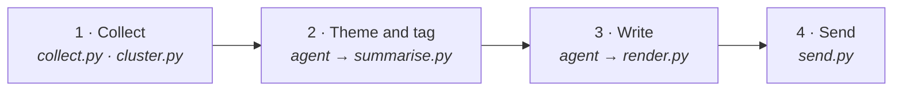

<div align="center">

# Feedback Brief Agent

**A weekly customer feedback brief, run entirely by the AI agent you already use.**

An example of an *agent as an application*: no app to deploy, just skills, a few small scripts, and checks every brief must pass.


[Quick start](#quick-start) · [What you get](#what-you-get) · [How it works](#how-it-works) · [Why it's safe](#why-its-safe) · [Project structure](#project-structure)

</div>

> [!NOTE]
> **AI agent reading this:** follow [AGENTS.md](AGENTS.md) now. Start setup with the user straight away; don't wait to be asked.

---

## Quick start

In any agent harness (Antigravity, Gemini CLI, Claude Code, Codex…), say:

```text
Clone https://github.com/Tomas-Lawton/agent-app-example, open it, and use the setup skill in setup/SKILL.md.
```

The [setup skill](setup/SKILL.md) then asks a few questions, one at a time:

| | Question | Example |
|:-:|---|---|
| 1 | **About you** | *"Capital Bank, for our Head of Customer Experience"* |
| 2 | **Where your feedback lives** | Zendesk, Intercom, BigQuery, an export file… |
| 3 | **Time window** | the last 7 days |
| 4 | **Output** | chat and email (default), with a guided app password |
| 5 | **Schedule** *(optional)* | *"every Monday at 8am"* |
| 6 | **Look** *(optional)* | colours, logo, header image |

The agent connects each source itself, shows you a sample before keeping it, then runs and sends your first brief. After that, just ask: *"why is the top theme growing?"*, *"make it shorter"*, *"add our survey export"*.

> [!TIP]
> **Requirements:** an agent harness and Python 3.9+. The agent installs everything else in the project's own `.venv`. Google Cloud is optional, for BigQuery or scheduled runs.

## What you get

<table>
<tr>
<td width="50%" valign="top">

**🎯 Things to act on**<br/>
Up to three actions, each with an owner and a draft ticket you can open pre-filled in GitHub, Linear or Jira. Nothing is filed for you.

</td>
<td width="50%" valign="top">

**💬 What customers are saying**<br/>
The main themes, with real quotes and sources, when each started and peaked, and who is affected.

</td>
</tr>
<tr>
<td valign="top">

**🚨 Watchlist**<br/>
Rare but serious feedback, such as scams or vulnerable customers, shown even when there are only a few items.

</td>
<td valign="top">

**👏 What's working**<br/>
What customers praise, worth passing on to the teams behind it.

</td>
</tr>
<tr>
<td valign="top">

**📊 Numbers and charts**<br/>
Volume, rating mix, trends, a priority matrix and a map of similar feedback, all counted by code.

</td>
<td valign="top">

**🔎 Every claim checked**<br/>
Quotes word for word, numbers from code, every sentence cited and one click from its evidence.

</td>
</tr>
</table>

## How it works

The agent does the judgement; a script ends each step, does the exact work, checks the agent's work, and stops with what to fix if anything is wrong.



| Step | The agent | The scripts |
|---|---|---|
| **1. Collect** | | Read your connections, remove personal details, keep the newest 500 items, group similar ones (TF-IDF, LSA, K-means) |
| **2. Theme and tag** | Reads every item, writes the themes, tags every item | Check every item is tagged, count each theme, compute trends |
| **3. Write** | Picks the actions, writes the brief with citations | Check every quote, number and citation; build the brief, preview and email |
| **4. Send** | Presents the brief, answers follow-ups | Rerun every check; email only your approved recipient |

### The use case and the client

| File | Is | Changed by |
|---|---|---|
| [`SKILL.md`](SKILL.md) | **The use case**: how to produce a feedback brief, the same for everyone | The developer |
| `profiles/<key>/PROFILE.md` | **The client**: a few settings, then plain text in their own words | You, any time (or ask the agent) |
| `profiles/<key>/user_scope.json` | **The client's reach**: connections, recipient, schedule | Setup only, with your confirmation |

A profile can change how the brief looks, never what it can reach.

<details>
<summary><b>Example <code>PROFILE.md</code></b></summary>

```yaml
---
product: Capital Bank of Australia
brief name: Customer Voice
reader: Head of Customer Experience
time window: 7
output: both
colours: brand #0b2545, brand2 #13315c, accent #c9a227, tint #eef2f8
tickets: github capital-bank/cx-feedback
---
Lead with anything that stops customers paying or logging in. Always surface scam reports.
```

Optional images (`logo.png`, `header.png`) go in `profiles/<key>/assets/`.

</details>

<details>
<summary><b>The engine scripts</b></summary>

| Script | What it does |
|---|---|
| [`steps/collect.py`](engine/steps/collect.py) | Reads every connection in the user scope, removes personal details and duplicates, keeps the newest 500 items |
| [`steps/cluster.py`](engine/steps/cluster.py) | Groups similar items for reading and lays out the map |
| [`steps/summarise.py`](engine/steps/summarise.py) | Checks tagging and quotes, counts themes, computes trends and scores |
| [`steps/render.py`](engine/steps/render.py) | Checks the writing and builds the brief, preview, email and charts |
| [`steps/send.py`](engine/steps/send.py) | The send gate: reruns every check and emails only the approved recipient |
| [`core/config.py`](engine/core/config.py) | Reads the use case scope, user scope and profile; refuses anything beyond the use case |
| [`core/checks.py`](engine/core/checks.py) | Every check on the agent's files |
| [`readers/`](engine/readers/) | One read-only reader each for an online service, a BigQuery table and a file |

The agent can also write throwaway code in its sandbox, for example to explore an unfamiliar API. Only these scripts collect feedback and send, so throwaway code can't widen its reach or skip a check.

</details>

## Why it's safe

Safety is designed into the use case, not left to the agent.

| | |
|---|---|
| ✅ **Every claim is checked** | Quotes word for word, numbers from code, every sentence cited. Unattended runs need an independent verifier to confirm each claim. |
| 🔒 **Reach is fixed** | Feedback is read only through `collect.py`, from read-only connections in your user scope, never beyond the use case. A refused connection stops there. |
| 📤 **One way out** | Only `send.py` sends, and only to your approved recipient. Nothing files tickets or posts anything. |
| 🧭 **Setup is separate from running** | Only setup changes reach, with your confirmation. Scheduled runs carry no setup skill, run in a read-only container, and use a least-privilege account. |

## Scheduling and configuration

<details>
<summary><b>Scheduled runs on Google Cloud</b></summary>

When you choose a schedule, setup deploys it for you, confirming each access change: a service account, Secret Manager for keys, a Cloud Run job from the [`Dockerfile`](Dockerfile), a Cloud Storage bucket for the runs, and Cloud Scheduler. Any scheduler that can start a headless harness works the same way.

</details>

<details>
<summary><b>Settings and secrets</b></summary>

Setup writes everything. Secrets live in `.env` in the project root (never committed), or in Secret Manager for scheduled runs.

| Setting | For |
|---|---|
| `SMTP_HOST`, `SMTP_PORT`, `SMTP_USER`, `SMTP_PASSWORD` | Email, through any provider with an app password |
| A key per online service, e.g. `ZENDESK_AUTH` | Services that need one |

BigQuery uses your Google credentials, or the cloud job's identity.

</details>

## Project structure

```text
├── AGENTS.md          what the agent does when the folder is opened
├── SKILL.md           the use case: steps, rules and file formats
├── setup/SKILL.md     the setup conversation, and deploying a scheduled run
├── Dockerfile         the scheduled run's container
├── requirements.txt   scikit-learn and matplotlib
├── engine/            scope.json · steps/ · core/ · readers/
└── profiles/          one folder per client, created by setup
```

Each run writes to `runs/<key>/<date>/` (not committed).

---

<div align="center">
<sub>Built as a working example for the article <i>Reliable Agents Don't Need Workflows</i>. Capital Bank of Australia is fictional.</sub>
</div>
