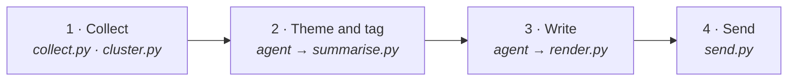

<div align="center">

# Customer Pulse

**A weekly pulse on what your customers are saying, run entirely by the AI agent you already use.**

An example of an *agent as an application*: no app to deploy, just skills, a few small scripts, and checks every pulse must pass.

</div>

> [!NOTE]
> **AI agent reading this:** follow [AGENTS.md](AGENTS.md) now. Start setup with the user straight away; don't wait to be asked.

## Quick start

In any agent harness (Antigravity, Gemini CLI, Claude Code, Codex…), say:

```text
Clone https://github.com/Tomas-Lawton/agent-app-example, open it, and use the setup skill in setup/SKILL.md.
```

The [setup skill](setup/SKILL.md) asks a few questions, connects your feedback sources, then runs and sends your first pulse. After that, just ask: *"why is the top theme growing?"*, *"make it shorter"*, *"add our survey export"*.

## What you get

<table>
<tr>
<td width="50%" valign="top">

**Things to act on**<br/>
Up to three actions, each with an owner and a draft ticket for the team.

</td>
<td width="50%" valign="top">

**What customers are saying**<br/>
The main themes, with quotes and sources.

</td>
</tr>
<tr>
<td valign="top">

**Watchlist**<br/>
Rare but serious feedback, such as scams or vulnerable customers.

</td>
<td valign="top">

**What's working**<br/>
What customers praise.

</td>
</tr>
<tr>
<td valign="top">

**Numbers and charts**<br/>
Volume, ratings, items per theme and trends, all counted by code.

</td>
<td valign="top">

**Every claim checked**<br/>
Quotes word for word, numbers from code, every sentence cited.

</td>
</tr>
</table>

## How it works

The agent does the judgement; a script ends each step, checks the agent's work, and stops with what to fix if anything is wrong.



| Step | The agent | The scripts |
|---|---|---|
| **1. Collect** | | Read your connections, remove personal details, keep the newest 500 items, group similar ones |
| **2. Theme and tag** | Reads every item, writes the themes, tags every item | Check every item is tagged, count each theme, compute trends |
| **3. Write** | Picks the actions, writes the pulse with citations | Check every quote, number and citation; build the pulse and email |
| **4. Send** | Presents the pulse, answers follow-ups | Rerun every check; email only your approved recipient |

### The use case and the client

| File | Is | Changed by |
|---|---|---|
| [`SKILL.md`](SKILL.md) | **The use case**: how to produce a Customer Pulse, the same for everyone | The developer |
| `profiles/<key>/PROFILE.md` | **The client**: a few settings, then plain text in their own words | You, any time |
| `profiles/<key>/user_scope.json` | **The client's reach**: connections, recipient, schedule | Setup only, with your confirmation |

<details>
<summary><b>Example <code>PROFILE.md</code></b></summary>

```yaml
---
product: Capital Bank of Australia
title: Customer Voice
reader: Head of Customer Experience
time window: 7
output: both
colours: brand #0b2545, brand2 #13315c, accent #c9a227
---
Lead with anything that stops customers paying or logging in. Always surface scam reports.
```

Optional images (`logo.png`, `header.png`) go in `profiles/<key>/assets/`.

</details>

<details>
<summary><b>The engine scripts</b></summary>

| Script | What it does |
|---|---|
| [`steps/collect.py`](engine/steps/collect.py) | Reads every connection, removes personal details and duplicates, keeps the newest 500 items |
| [`steps/cluster.py`](engine/steps/cluster.py) | Groups similar items for reading |
| [`steps/summarise.py`](engine/steps/summarise.py) | Checks tagging and quotes, counts themes, computes trends |
| [`steps/render.py`](engine/steps/render.py) | Checks the writing and builds the pulse (one page for the email and the preview) and a short chat summary |
| [`steps/send.py`](engine/steps/send.py) | The send gate: reruns every check and emails only the approved recipient |
| [`core/config.py`](engine/core/config.py) | Reads the scope and profile; refuses anything beyond the use case |
| [`core/checks.py`](engine/core/checks.py) | Every check on the agent's files |
| [`readers/`](engine/readers/) | Read-only readers for an online service, a BigQuery table and a file |

</details>

<details>
<summary><b>Scheduling and secrets</b></summary>

Setup can deploy a scheduled run on Google Cloud (a Cloud Run job from the [`Dockerfile`](Dockerfile), with Secret Manager and Cloud Scheduler); any scheduler that can start a headless harness works the same way. Secrets live in `.env` in the project root, never committed.

</details>

---

<div align="center">
<sub>A working example for the article <i>Reliable Agents Don't Need Workflows</i>. Capital Bank of Australia is fictional.</sub>
</div>
